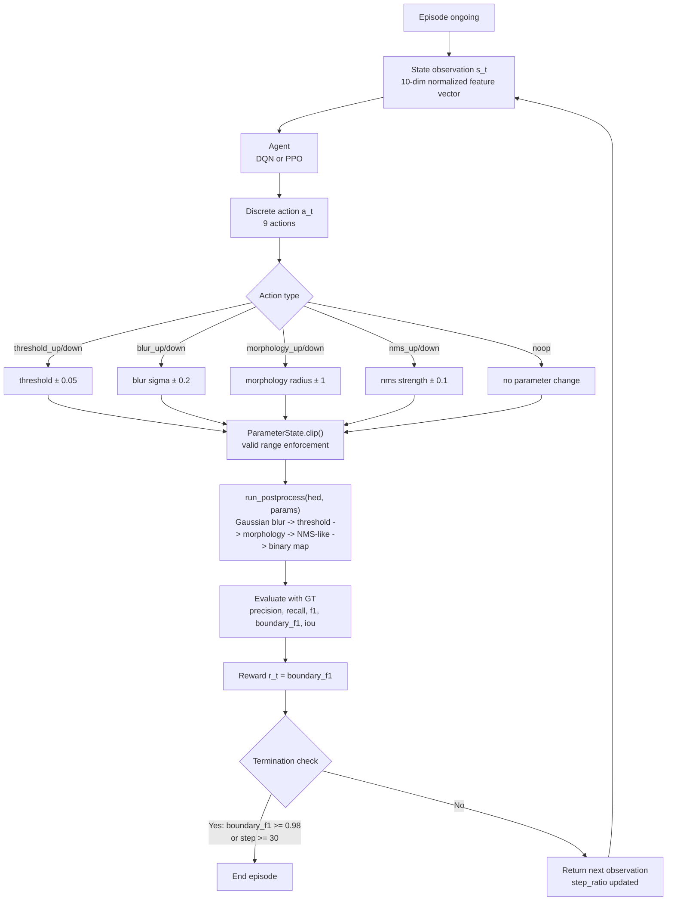
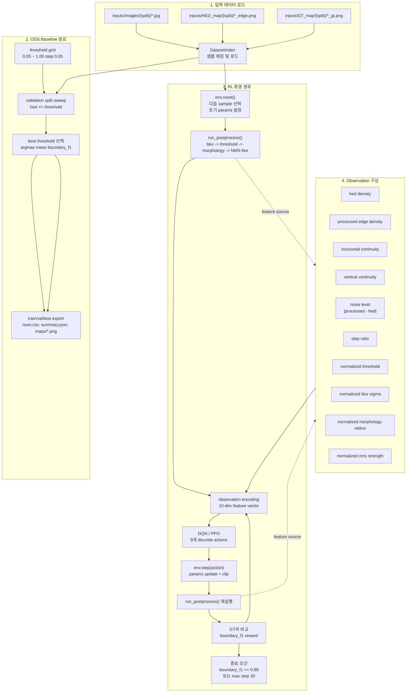

# HED Post-Processing RL 개발 문서

## 1. 문서 목적

이 문서는 `HED Post-processing DQN·PPO 비교 연구` 기획서를 기준으로 현재 저장소의 개발 방향, 시스템 구조, 실행 절차, 확장 포인트를 정리한 개발 문서다.

현재 개발 우선순위는 강화학습 실험 자체보다 먼저, HED edge map을 ODS 기반으로 binary edge map으로 변환하는 독립 모듈을 정식 구현하는 것이다.

목표는 다음 두 가지다.

- 기획서 요구사항을 코드 구조와 실행 절차로 번역한다.
- 현재 구현 범위와 미구현 범위를 명확히 구분한다.

## 1.1 최근 업데이트 요약

최근 업데이트에서 반영된 핵심 사항은 다음과 같다.

- DQN 안정성 로그에 `q_max`를 추가했다.
- seed `486` 기준 DQN, PPO `200,000 timesteps` 재학습을 수행했다.
- DQN/PPO 공통 학습 그래프와 HED 대비 binary F1, boundary F1, IoU 비교 그래프를 생성했다.
- all-seed 집계 파일과 논문용 요약 문서를 갱신했다.

주요 산출물은 아래 경로에 저장되어 있다.

- `runs/dqn_seed486_sqrt8/plots/dqn_stability_q_max.png`
- `runs/seed486_compare/`
- `runs/all_seed_test_summary.csv`
- `runs/all_seed_test_summary.md`
- `runs/paper_seed486_summary.md`

## 2. 프로젝트 목표

1차 목표는 HED edge map에서 ODS 기반 단일 threshold를 추정해 안정적인 binary edge map을 생성하는 모듈을 구축하는 것이다.

2차 목표는 강화학습을 활용해 HED 후처리 파이프라인의 최적 파라메터를 자동 탐색하고, 값 기반 DQN과 정책 기반 PPO의 성능을 비교 분석하는 것이다.

최종적으로 비교하려는 항목은 다음과 같다.

- ODS 기반 binary edge map의 baseline 품질
- 학습 안정성
- 이미지별 후처리 성능

현재 최신 비교 기준에는 seed `486` 실험 결과도 포함된다.

### 2.1 seed 486 최신 결과

test split 기준 최신 성능 요약은 다음과 같다.

| 방법 | reward_mean | binary F1 mean | boundary F1 mean | IoU mean |
| --- | ---: | ---: | ---: | ---: |
| HED baseline | 0.0000 | 0.4117 | 0.7551 | 0.2614 |
| DQN seed 486 | 22.5252 | 0.4088 | 0.7515 | 0.2591 |
| PPO seed 486 | 22.3334 | 0.3901 | 0.7262 | 0.2445 |

해석은 다음과 같다.

- DQN은 binary F1, boundary F1, IoU 모두에서 HED baseline에 근접했다.
- PPO는 seed 486 기준으로 DQN과 HED보다 낮은 성능을 보였다.
- boundary F1 기준으로는 DQN이 PPO보다 높았지만, HED baseline을 넘지는 못했다.
<!-- 
- 고정 threshold 방식 대비 개선 여부
- GT 기준 F1, IoU, boundary-aware F1 성능
 -->

## 3. 데이터 구조

현재 워크스페이스는 아래 구조를 사용한다.

```text
inputs/
  GT_map/
    test/
    train/
    val/
  HED_map/
    test/
    train/
    val/
  images/
    test/
    train/
    val/
```

파일 매칭 규칙은 다음과 같다.

- 입력 이미지: `inputs/images/{split}/{sample_id}.jpg`
- HED 맵: `inputs/HED_map/{split}/{sample_id}_edge.png`
- GT 맵: `inputs/GT_map/{split}/{sample_id}_gt.png`

현재 확인된 샘플 수는 다음과 같다.

- train: 200장
- val: 100장
- test: 200장

## 4. 요구사항 해석

기획서 기준 핵심 요구사항은 아래와 같이 해석한다.

### 4.0 ODS 기반 binary edge map 모듈

강화학습 환경에 앞서 먼저 구현할 기능은 HED score map을 ODS 기반 binary edge map으로 변환하는 모듈이다.

이 모듈의 요구사항은 다음과 같다.

- 입력은 split별 HED edge map과 GT edge map이다.
- validation split에서 threshold sweep을 수행해 데이터셋 공통 threshold를 선택한다.
- 선택 기준은 현재 저장소의 기본 평가 지표인 boundary-aware F1을 우선 사용한다.
- 선택된 threshold를 사용해 target split의 HED map을 binary edge map으로 변환한다.
- 결과로 선택 threshold, split별 요약 metric, 샘플별 metric, binary edge map 파일을 저장한다.

현재 단계에서는 엄밀한 benchmark 스타일 ODS 대신, validation split 전체 성능을 최대화하는 실용적 ODS baseline을 먼저 구현한다.

현재 구현된 ODS threshold 생성 알고리즘은 다음 순서로 동작한다.

1. threshold 후보 집합 생성
2. validation split 전체에 대해 각 threshold 후보 평가
3. threshold별 평균 metric 계산
4. `boundary_f1_mean` 이 최대가 되는 threshold 선택
5. 선택된 threshold를 target split 전체에 고정 적용
6. binary edge map PNG, 샘플별 metric CSV, split 요약 JSON/PNG 저장

세부 절차는 아래와 같다.

#### 4.0.1 threshold 후보 집합 생성

- threshold 후보는 기본적으로 `0.05`부터 `1.0`까지 `0.05` 간격으로 생성한다.
- 즉 기본 후보 집합은 `0.05, 0.10, 0.15, ..., 1.00` 이다.
- 이 값들은 HED score map을 직접 binary map으로 바꾸는 이진화 임계값이다.

#### 4.0.2 threshold별 validation 평가

- validation split의 모든 샘플에 대해 동일 threshold를 적용한다.
- 각 샘플의 HED map에 대해 픽셀 단위 이진화 `binary = (hed >= threshold)` 를 수행한다.
- 이렇게 얻은 binary map을 GT edge map과 비교해 정량 지표를 계산한다.
- 현재 계산 지표는 `precision`, `recall`, `f1`, `boundary_f1`, `iou` 이다.

즉, threshold 후보 하나에 대해 validation split 전체를 한 번 순회하며 아래를 반복한다.

$$
B_i(t) = \mathbf{1}(H_i \ge t)
$$

여기서 $H_i$ 는 $i$번째 샘플의 HED map, $t$ 는 threshold, $B_i(t)$ 는 threshold 적용 후 binary edge map이다.

#### 4.0.3 threshold 선택 기준

- 각 threshold 후보에 대해 validation split 전체의 샘플별 metric 평균을 계산한다.
- 현재 ODS 선택 기준은 `boundary_f1_mean` 최대값이다.
- 따라서 선택 threshold $t^*$ 는 다음과 같이 정의한다.

$$
t^* = \arg\max_t \; \mathrm{meanBoundaryF1}(D_{val}, t)
$$

- 동률이 발생하면 현재 구현은 먼저 등장한 threshold를 유지한다.
- 따라서 sweep 순서상 더 작은 threshold가 선택될 수 있다.

#### 4.0.4 target split 적용 방식

- validation에서 선택된 단일 threshold를 train, val, test 전체에 동일하게 적용한다.
- target split에서는 threshold를 다시 탐색하지 않는다.
- 각 샘플 결과는 `sample_id_ods_binary.png` 형식의 binary edge map으로 저장한다.

이 구조는 ODS의 핵심인 dataset-level 단일 threshold 적용이라는 원칙을 따른다.

#### 4.0.5 저장 산출물

현재 구현은 아래 산출물을 저장한다.

- `ods_threshold.json`: 선택 split, target split, 최종 threshold, 선택 요약 metric 저장
- `threshold_sweep.csv`: threshold 후보별 평균 metric 저장
- `selection_summary.png`: 선택 split 기준 요약 성능 plot 저장
- split별 `rows.csv`: 샘플별 metric 저장
- split별 `manifest.csv`: 각 sample_id 와 저장된 PNG 경로 저장
- split별 `summary.json`: split 평균 metric 저장
- split별 `summary.png`: split 요약 성능 plot 저장
- split별 `maps/*.png`: ODS binary edge map 저장

#### 4.0.6 현재 구현의 성격과 한계

- 현재 구현은 raw HED map에 threshold만 적용하는 ODS baseline이다.
- blur, morphology, NMS 같은 후처리 파라미터는 ODS 선택 과정에 포함되지 않는다.
- 따라서 이 모듈은 후처리 전체 최적화가 아니라, HED score map의 dataset-level binary thresholding 기준선을 제공하는 역할이다.
- 또한 strict benchmark 스타일 ODS처럼 데이터셋 전체 TP/FP/FN을 직접 합산해 F-score를 계산하는 방식이 아니라, 현재는 샘플별 metric 평균을 기반으로 threshold를 선택한다.

즉, 현재 구현은 연구용 프로토타입에 적합한 실용적 ODS이고, 이후 필요하면 더 엄밀한 dataset-level ODS 계산으로 확장할 수 있다.

#### 4.0.7 논문 기술용 정리

논문에서는 ODS를 다음과 같이 기술하는 것이 적절하다.

ODS는 Optimal Dataset Scale의 약자로, 데이터셋 전체에 공통으로 적용할 단일 threshold를 선택하는 평가 및 이진화 기준이다. 즉, 각 이미지마다 서로 다른 threshold를 사용하는 것이 아니라, validation 데이터셋 전체에서 가장 우수한 성능을 보이는 하나의 threshold를 선택한 뒤 이를 target split 전체에 동일하게 적용한다.

본 연구에서는 HED가 출력한 연속값 edge score map $H$ 에 threshold $t$ 를 적용하여 binary edge map $B(t)$ 를 생성한다.

$$
B(t) = \mathbf{1}(H \ge t)
$$

여기서 $\mathbf{1}(\cdot)$ 는 indicator function이다. Threshold 후보 집합 $\mathcal{T}$ 에 대해 validation split 전체를 평가하고, 각 threshold에서 얻어진 성능 중 데이터셋 평균 boundary-aware F1이 최대가 되는 threshold를 ODS threshold로 정의한다.

$$
t^* = \arg\max_{t \in \mathcal{T}} \; \frac{1}{N} \sum_{i=1}^{N} \mathrm{BF1}(B_i(t), G_i)
$$

여기서 $N$ 은 validation split의 샘플 수, $B_i(t)$ 는 $i$번째 HED map에 threshold $t$ 를 적용해 얻은 binary edge map, $G_i$ 는 해당 ground-truth edge map, $\mathrm{BF1}(\cdot)$ 는 boundary-aware F1 score이다.

본 구현에서 threshold 후보 집합은 `0.05`부터 `1.00`까지 `0.05` 간격으로 구성하였다. 각 후보 threshold에 대해 validation split 전체를 순회하면서 binary edge map을 생성하고, precision, recall, F1, boundary-aware F1, IoU를 계산한다. 이후 평균 boundary-aware F1이 최대가 되는 threshold를 선택하고, 선택된 단일 threshold를 train, val, test split 전체에 동일하게 적용하여 ODS 기반 binary edge map을 생성한다.

이때 본 연구의 ODS는 BSDS benchmark에서 사용되는 엄밀한 의미의 dataset-level ODS와는 약간 다르다. 전통적인 ODS 평가는 threshold별로 데이터셋 전체의 true positive, false positive, false negative를 누적한 뒤 precision-recall 곡선과 F-score를 계산하는 방식으로 정의될 수 있다. 반면 본 구현은 연구용 프로토타입의 단순성과 재현성을 고려하여, 샘플별 boundary-aware F1의 평균을 기준으로 threshold를 선택하는 practical ODS를 사용하였다.

따라서 본 논문에서 ODS는 다음 두 가지 목적을 가진다.

- 첫째, 강화학습 기반 후처리 이전에 HED score map 자체가 달성할 수 있는 dataset-level binary thresholding baseline을 제공한다.
- 둘째, 이후 DQN 및 PPO 기반 후처리 결과와 비교할 수 있는 비학습 기준선을 제공한다.

논문 서술에서는 아래와 같이 요약할 수 있다.

"본 연구는 HED가 생성한 edge score map을 binary edge map으로 변환하기 위해 ODS 기반 thresholding을 사용하였다. ODS threshold는 validation split에서 threshold sweep을 수행하여 평균 boundary-aware F1을 최대화하는 단일 threshold로 선택하였으며, 선택된 threshold를 target split 전체에 동일하게 적용하였다. 이를 통해 데이터셋 수준에서 일관된 이진화 기준선을 확보하고, 이후 강화학습 기반 후처리 결과와 비교 가능한 baseline을 구성하였다."

### 4.1 환경 설계

- OpenAI Gym 계열 인터페이스 사용
- `reset()`과 `step(action)` 중심의 에피소드 진행
- 한 에피소드는 한 장의 이미지를 대상으로 함
- 최대 스텝 수는 30

현재 구현 기준에서 DQN과 PPO는 동일한 환경을 공유한다.

- train split으로 학습 환경을 구성한다.
- val split으로 평가 환경을 구성한다.
- 기본 학습 길이는 알고리즘별 `200,000 timesteps`로 둔다.
- observation은 길이 10의 정규화 feature vector다.
- reward는 step마다 계산되는 boundary-aware F1 값이다.
- episode 종료 조건은 `boundary_f1 >= 0.98` 또는 최대 step 도달이다.

현재 구현의 step/action 루프는 아래와 같다.



위 다이어그램에서 상태 벡터는 아래 항목으로 구성된다.

- `hed_density`
- `processed_edge_density`
- `continuity_horizontal`
- `continuity_vertical`
- `noise_level`
- `step_ratio`
- 정규화된 `threshold`
- 정규화된 `blur_sigma`
- 정규화된 `morphology_radius`
- 정규화된 `nms_strength`

학습 로그 정책은 다음과 같이 정의한다.

- 총 학습 구간 `200,000 timesteps` 동안 중간 출력 데이터를 기록한다.
- 출력 데이터는 `1,000 timestep` 단위로 추출한다.
- 추출 결과는 CSV 파일로 저장한다.
- CSV에는 최소한 timestep, reward 또는 평가 metric, 주요 파라미터 또는 validation 요약값이 포함되도록 설계한다.

현재 구현에서 알고리즘별 안정성 로그는 아래와 같다.

- DQN: `q_mean`, `q_max`, `q_std`, `td_error_mean`, `td_error_std`, `td_error_abs_mean`, `exploration_rate`
- PPO: `explained_variance`, `approx_kl`, `clip_fraction`, `value_loss`, `entropy_loss`

즉, 최신 DQN 실험에서는 값 함수의 평균 스케일뿐 아니라 최대값 스케일도 `q_max`로 직접 추적할 수 있다.

### 4.2 상태(State)

입력 이미지 및 현재 파라메터 세팅(Threshold, Blur σ, NMS 강도, Morphology Kernel 등).
에지 밀도(edge density), 연속성(edge continuity), 반복 횟수 등 중간 통계 피쳐 포함.

현재 후처리 파라미터 정의는 다음과 같다.

- Threshold: HED 엣지 맵 이진화 임계값, 가동범위 `0.05 ~ 1.0`, 조정단위 `±0.05`
- Blur Sigma: Gaussian blur 표준편차, 가동범위 `0.2 ~ 3.0`, 조정단위 `±0.2`
- Morphology Radius: morphological closing 커널 반경, 가동범위 `1 ~ 7`, 조정단위 `정수 ±1`
- NMS Strength: 엣지와 잡음에 대한 erosion 유사 강도, 가동범위 `0.2 ~ 1.0`, 조정단위 `±0.1`

초기값은 현재 구현 기준으로 다음과 같다.

- Threshold: `0.5`
- Blur Sigma: `1.0`
- Morphology Radius: `1`
- NMS Strength: `0.5`

<!-- 
기획서의 상태 정의는 `HED baseline edge map`, 현재 파라미터 상태, 에피소드 진행률을 포함한다.

현재 구현에서는 이를 다음 feature vector로 단순화했다.

- HED density
- 출력 edge density
- 수평 연속성
- 수직 연속성
- 출력과 HED 차이 기반 noise level
- step ratio
- threshold 정규화 값
- blur sigma 정규화 값
- morphology radius 정규화 값
- nms strength 정규화 값

총 observation 크기는 10이다.
 -->

### 4.3 행동(Action)

파라메터 증감(예: Threshold ±1, Gaussian Blur σ ±0.2, NMS 강도 ±0.1).
연속 파라메터는 범위를 이산화하거나 PPO에서 직접 연속 제어.

현재 구현에서 각 action은 아래 단위로 파라미터를 한 번씩 조정한다.

- `threshold_up`, `threshold_down`: `±0.05`
- `blur_up`, `blur_down`: `±0.2`
- `morphology_up`, `morphology_down`: `정수 ±1`
- `nms_up`, `nms_down`: `±0.1`
- `noop`: 파라미터 변경 없음

현재 저장소 구현에서는 DQN과 PPO 모두 동일한 이산 행동 공간을 사용한다.

행동 집합은 다음 9개다.

- `threshold_up`
- `threshold_down`
- `blur_up`
- `blur_down`
- `morphology_up`
- `morphology_down`
- `nms_up`
- `nms_down`
- `noop`

즉, 현재 PPO는 연속 action PPO가 아니라 discrete action PPO로 동작한다.

<!-- 
기획서의 파라미터는 아래 4개다.

- threshold
- blur sigma
- morphology radius
- NMS strength

현재 구현에서는 공정 비교를 위해 DQN과 PPO 모두 동일한 이산 행동 공간을 사용한다.

행동 집합은 다음과 같다.

- `threshold_up`
- `threshold_down`
- `blur_up`
- `blur_down`
- `morphology_up`
- `morphology_down`
- `nms_up`
- `nms_down`
- `noop`
 -->

### 4.4 보상(Reward)

보상 함수는 에이전트가 생성한 후처리 결과 binary edge map과 Ground Truth 에지 맵 사이의 일치도를 기준으로 계산한다.

구체적으로는 각 step에서 생성된 에지 맵을 GT 맵과 비교하여 `precision`, `recall`, `f1`, `boundary_f1`, `iou`를 산출하며, 이 중 `boundary_f1` 값을 reward로 사용한다.

즉, 현재 구현의 보상은 정식 BPR(Boundary Precision-Recall) 기반 F1을 직접 계산하는 방식이 아니라, 허용 반경 내 경계 일치를 기준으로 precision과 recall을 계산한 뒤 이를 종합한 boundary-aware F1 score를 사용하는 방식이다. 따라서 step `t`에서의 reward 반환값 `r_t`는 현재 후처리 결과에 대한 boundary-aware F1 score로 정의된다.

현재 구현은 아래 이유로 완전한 BPR 대신 boundary-aware F1 근사를 사용한다.

- 초기 연구용 프로토타입을 빠르게 검증하기 위함
- SB3 기반 환경 디버깅을 단순화하기 위함
- 픽셀 단위 F1보다 위치 오차 허용이 가능한 지표를 유지하기 위함

현재 보상은 `boundary_f1_score()` 반환값이다.

논문 또는 보고서에서 학습 안정성 설명에 사용할 수 있는 대표 그래프는 다음과 같다.

- DQN `q_max` 변화: `runs/dqn_seed486_sqrt8/plots/dqn_stability_q_max.png`
- DQN/PPO 공통 validation reward 비교: `runs/seed486_compare/eval_compare_reward_mean.png`
- HED, DQN, PPO test boundary F1 비교: `runs/seed486_compare/test_compare_boundary_f1.png`
- HED, DQN, PPO test binary F1 비교: `runs/seed486_compare/test_compare_binary_f1.png`
- HED, DQN, PPO test IoU 비교: `runs/seed486_compare/test_compare_iou.png`

## 5. 현재 시스템 구조

현재 버전의 실제 구조는 아래와 같다.

- 저장소 내부에서 Caffe 기반 HED 추론을 수행하지 않는다.
- 이미 생성된 `images`, `HED_map`, `GT_map` 쌍을 로드한다.
- ODS baseline 경로와 RL 환경 경로가 같은 입력 데이터를 공유한다.
- RL 환경은 `reset()` 시 샘플을 선택하고, `step()` 마다 후처리 파라미터를 갱신한다.



이 다이어그램은 현재 구현을 기준으로 다음 사실을 반영한다.

- HED 모델 추론은 외부에서 끝난 것으로 간주하고, 저장소는 결과 맵을 입력으로 사용한다.
- ODS는 raw HED map에 threshold만 적용하는 baseline 경로다.
- RL은 ODS 결과를 다시 입력으로 받지 않고, 원본 HED map에서 직접 후처리를 반복 적용한다.
- observation에는 `target parameter` 나 `user vs target difference` 같은 항목이 없고, 현재는 통계 feature 6개와 파라미터 feature 4개만 사용한다.

```text
main.py
hed_rl/
  __init__.py
  config.py
  data.py
  env.py
  evaluation.py
  features.py
  inference.py
  metrics.py
  postprocess.py
  reporting.py
  training.py
```

모듈별 역할은 다음과 같다.

### 5.1 `main.py`

CLI 진입점이다.

지원 명령:

- `baseline`
- `train`
- `export-samples`

### 5.2 `hed_rl/config.py`

실험 설정 및 후처리 파라미터 기본값을 정의한다.

- `ParameterState`
- `PostProcessConfig`
- `ExperimentConfig`

현재 설정값은 다음과 같다.

- `ParameterState.threshold`: 기본값 `0.5`, clip 범위 `0.05 ~ 1.0`
- `ParameterState.blur_sigma`: 기본값 `1.0`, clip 범위 `0.2 ~ 3.0`
- `ParameterState.morphology_radius`: 기본값 `1`, clip 범위 `1 ~ 7`
- `ParameterState.nms_strength`: 기본값 `0.5`, clip 범위 `0.2 ~ 1.0`
- `PostProcessConfig.threshold_step`: `0.05`
- `PostProcessConfig.blur_step`: `0.2`
- `PostProcessConfig.morphology_step`: `1`
- `PostProcessConfig.nms_step`: `0.1`

### 5.3 `hed_rl/data.py`

데이터셋 탐색과 이미지 로딩을 담당한다.

- split별 샘플 자동 매칭
- RGB 입력 이미지 로딩
- HED, GT grayscale 로딩

### 5.4 `hed_rl/postprocess.py`

후처리 파이프라인과 action-to-parameter 업데이트 로직을 담당한다.

현재 파이프라인 순서는 다음과 같다.

1. Gaussian blur
2. threshold binarization
3. morphology 유사 closing
4. NMS 유사 thinning
5. 최종 binary edge map 생성

### 5.5 `hed_rl/metrics.py`

평가 지표를 계산한다.

- pixel-wise precision / recall / F1
- IoU
- tolerance 기반 boundary-aware F1

### 5.6 `hed_rl/features.py`

환경 observation feature를 생성한다.

### 5.7 `hed_rl/env.py`

Gymnasium 환경 구현이다.

주요 역할:

- episode 시작 시 다음 이미지 로드
- action 적용 후 후처리 재실행
- reward 계산
- 종료 조건 판단

에이전트 관점에서의 환경 정의는 다음과 같다.

- action space: `Discrete(9)`
- observation space: `Box(low=0.0, high=1.0, shape=(10,))`
- 초기 파라메터: `threshold=0.5`, `blur_sigma=1.0`, `morphology_radius=1`, `nms_strength=0.5`
- 파라메터 clip 범위: `threshold 0.05~1.0`, `blur_sigma 0.2~3.0`, `morphology_radius 1~7`, `nms_strength 0.2~1.0`
- action step 크기: `threshold 0.05`, `blur_sigma 0.2`, `morphology_radius 1`, `nms_strength 0.1`
- 한 step마다 action으로 파라메터를 갱신하고 후처리를 다시 수행한다.
- reward는 현재 출력과 GT의 `boundary_f1` 값이다.

종료 조건:

- `boundary_f1 >= 0.98`
- 또는 `max_episode_steps == 30`

### 5.8 `hed_rl/training.py`

Stable-Baselines3 기반 DQN, PPO 학습을 담당한다.

구성 요소:

- train env
- validation eval env
- TensorBoard 로그
- best model 저장
- 최종 model 저장

현재 구현된 DQN과 PPO의 공통점은 다음과 같다.

- 둘 다 `MlpPolicy`를 사용한다.
- 둘 다 동일한 train env와 val eval env를 사용한다.
- 둘 다 같은 observation, reward, action semantics 위에서 학습한다.
- 둘 다 `EvalCallback`으로 5000 step마다 validation 환경 평가를 수행한다.
- 둘 다 `runs/{run_name}` 아래에 tensorboard, eval_logs, best_model, final model을 저장한다.
- 기본 학습 timesteps는 `200,000`이다.

개발 문서 기준의 목표 출력 정책은 다음과 같다.

- 학습 진행 중 `1,000 timestep`마다 중간 결과를 추출한다.
- 추출 결과는 학습 곡선 분석용 CSV로 저장한다.
- DQN과 PPO 모두 동일한 간격과 동일한 컬럼 체계를 사용한다.
- 학습 완료 후에는 안정성, 학습 과정 비교, 최종 eval 비교 그래프를 PNG로 저장한다.
- 각 PNG 그래프의 원본 수치도 CSV로 함께 저장한다.

그래프 시각화 규칙은 다음과 같이 고정한다.

- DQN 계열 선 그래프는 RGB `(35, 156, 35)`, 즉 `#239C23` 색상을 사용한다.
- PPO 계열 선 그래프는 RGB `(245, 124, 0)`, 즉 `#F57C00` 색상을 사용한다.
- DQN과 PPO를 같은 축에서 비교하는 그래프에서도 동일한 색상 매핑을 유지한다.
- 시계열 선 그래프는 모두 smoothing factor `0.7`을 적용한 exponential smoothing 결과로 시각화한다.
- smoothing은 원본 CSV 값을 변경하지 않고, PNG 렌더링 시각화 단계에만 적용한다.

요구되는 정량 지표 그래프 파일은 다음과 같다.

DQN 안정성:

- 아래 파일명에서 `dqn_` 접두사는 DQN 학습 결과 기반 그래프를 뜻한다.
- 각 지표는 총 `200,000 timesteps` 구간에서 `1,000 timestep` 간격으로 추출한다.
- 즉, 각 지표는 최대 200개 시점의 시계열 로그를 CSV로 먼저 저장한 뒤, 그 CSV를 기반으로 PNG 그래프를 생성한다.

- `dqn_stability_q_mean.png`
- `dqn_stability_q_std.png`
- `dqn_stability_td_error_mean.png`
- `dqn_stability_td_error_std.png`
- `dqn_stability_td_error_abs_mean.png`
- `dqn_stability_exploration_rate.png`

PPO 안정성:

- 아래 파일명에서 `ppo_` 접두사는 PPO 학습 결과 기반 그래프를 뜻한다.
- 각 지표는 총 `200,000 timesteps` 구간에서 `1,000 timestep` 간격으로 추출한다.
- 즉, 각 지표는 최대 200개 시점의 시계열 로그를 CSV로 먼저 저장한 뒤, 그 CSV를 기반으로 PNG 그래프를 생성한다.
- `ppo_` 로 시작하는 PNG 파일은 PPO 학습 완료 후 생성되는 안정성 리포트 이미지다.
- 이때 원본 로그는 `explained_variance`, `approx_kl`, `clip_fraction`, `value_loss`, `entropy_loss`를 `1,000 timestep` 단위로 기록한 CSV여야 한다.
- PNG는 해당 CSV에 저장된 PPO 지표 시계열을 그대로 시각화한 결과여야 한다.

- `ppo_stability_explained_variance.png`
- `ppo_stability_approx_kl.png`
- `ppo_stability_clip_fraction.png`
- `ppo_stability_value_loss.png`
- `ppo_stability_entropy_loss.png`

학습 과정 비교:

- `training_` 으로 시작하는 PNG 파일은 학습 과정에서 추출한 정량 지표 시계열 그래프를 뜻한다.
- 각 지표는 총 `200,000 timesteps` 구간에서 `1,000 timestep` 간격으로 추출한다.
- 원본 로그는 `episode_reward_mean`, `episode_reward_std`, `episode_length_mean`, `episode_length_std`를 CSV로 먼저 저장한 뒤, 그 CSV를 기반으로 PNG 그래프를 생성한다.
- 이 그래프들은 DQN과 PPO를 동일 축에서 비교하는 학습 과정 리포트다.

- `training_episode_reward_mean.png`
- `training_episode_reward_std.png`
- `training_episode_length_mean.png`
- `training_episode_length_std.png`

최종 eval 비교:

- 평가도 동일하게 총 `200,000 timesteps` 구간을 기준으로 진행한다.
- 평가 로그는 `1,000 timestep` 간격으로 `reward_mean`, `reward_std`, `reward_max`를 추출해 CSV로 저장한다.
- PNG는 해당 CSV를 기반으로 생성하며 파일명은 `eval_compare_{정량지표명}.png` 규칙을 따른다.
- 이 그래프들은 DQN과 PPO의 평가 성능 변화를 동일 축에서 비교하는 정량 리포트다.

- `eval_compare_reward_mean.png`
- `eval_compare_reward_std.png`
- `eval_compare_reward_max.png`

CSV 저장 원칙은 다음과 같다.

- 각 PNG에 대응하는 source metric을 CSV로 저장한다.
- 또는 범주별 묶음 CSV를 사용하되, 파일명과 컬럼명으로 PNG 대응 관계가 즉시 드러나야 한다.
- 모든 CSV는 최소한 `timestep` 또는 `evaluation_step`, `algorithm`, `metric_name`, `metric_value` 정보를 포함해야 한다.
- DQN 안정성 CSV에는 `q_mean`, `q_std`, `td_error_mean`, `td_error_std`, `td_error_abs_mean`, `exploration_rate`가 `1,000 timestep` 간격으로 저장되어야 한다.
- PPO 안정성 CSV에는 `explained_variance`, `approx_kl`, `clip_fraction`, `value_loss`, `entropy_loss`가 `1,000 timestep` 간격으로 저장되어야 한다.
- 학습 과정 CSV에는 `episode_reward_mean`, `episode_reward_std`, `episode_length_mean`, `episode_length_std`가 `1,000 timestep` 간격으로 저장되어야 한다.
- 평가 CSV에는 `reward_mean`, `reward_std`, `reward_max`가 `1,000 timestep` 간격으로 저장되어야 한다.
- 즉, `ppo_stability_explained_variance.png` 같은 파일은 대응 CSV의 `explained_variance` 열 또는 같은 의미의 metric row를 시각화한 결과여야 한다.
- `ppo_stability_approx_kl.png`, `ppo_stability_clip_fraction.png`, `ppo_stability_value_loss.png`, `ppo_stability_entropy_loss.png` 도 동일한 규칙을 따른다.
- `training_episode_reward_mean.png`, `training_episode_reward_std.png`, `training_episode_length_mean.png`, `training_episode_length_std.png` 도 대응 CSV의 같은 이름 metric을 시각화한 결과여야 한다.
- `eval_compare_reward_mean.png`, `eval_compare_reward_std.png`, `eval_compare_reward_max.png` 도 대응 CSV의 같은 이름 metric을 시각화한 결과여야 한다.

현재 코드 구현과의 차이는 다음과 같다.

- 총 학습 길이 `200,000 timesteps`는 이미 기본값으로 설정되어 있다.
- 현재 validation callback 주기는 `5,000 step`이다.
- 현재 구현은 training, eval, stability 계열 CSV와 PNG를 생성한다.
- 시계열 PNG 생성 시 DQN은 `#239C23`, PPO는 `#F57C00`으로 렌더링하며, smoothing factor `0.7`을 적용한다.

현재 구현된 차이점은 다음과 같다.

- DQN은 replay buffer 기반 value-learning으로 동작한다.
- PPO는 on-policy 정책 최적화로 동작한다.
- DQN 기본 설정은 `learning_starts=1000`, `buffer_size=50000` 이다.
- PPO 기본 설정은 `n_steps=512`, `batch_size=128` 이다.

현재 단계에서 DQN과 PPO는 ODS threshold를 직접 학습하는 모듈이 아니라, ODS baseline 이후 확장되는 후처리 제어 에이전트로 위치시킨다.

### 5.9 `hed_rl/evaluation.py`

현재는 고정 파라미터 baseline 평가를 담당한다.

개발 우선순위 기준으로는 ODS threshold sweep과 binary edge map export 기능까지 이 모듈 또는 별도 ODS 전용 모듈로 확장하는 것이 다음 단계다.

### 5.10 `hed_rl/inference.py`

학습된 모델을 로드해서 샘플 이미지를 저장한다.

출력 예시:

- 원본 image
- HED
- GT
- policy output

### 5.11 `hed_rl/reporting.py`

CSV, JSON, PNG 요약 리포트를 저장한다.

확장 시에는 아래 리포트 생성 책임도 포함한다.

- DQN 안정성 지표 PNG 및 CSV 생성
- PPO 안정성 지표 PNG 및 CSV 생성
- DQN, PPO 학습 과정 비교 PNG 및 CSV 생성
- 최종 eval 비교 PNG 및 CSV 생성

## 6. 실행 방법

현재 문서 기준에서 우선 개발 대상은 ODS binary edge map 생성 모듈이다. 아래 실행 예시는 현재 구현된 baseline/RL 기능을 설명하기 위한 참고 절차이며, ODS 전용 CLI는 구현 후 별도 추가한다.

### 6.1 baseline 평가

```powershell
& ".venv/Scripts/python.exe" .\main.py baseline --split val --output-dir runs\baseline_val
```

출력 파일:

- `val_rows.csv`
- `val_summary.json`
- `val_summary.png`

### 6.2 DQN 학습

```powershell
& ".venv/Scripts/python.exe" .\main.py train --algorithm dqn --timesteps 200000 --run-name dqn_main
```

문서 기준 기대 산출물:

- 최종 모델
- best model
- TensorBoard 로그
- `1,000 timestep` 간격 학습 로그 CSV
- DQN 안정성 그래프 PNG
- DQN 안정성 source CSV
- 학습 과정 정량지표 비교 PNG
- 학습 과정 정량지표 source CSV

### 6.3 PPO 학습

```powershell
& ".venv/Scripts/python.exe" .\main.py train --algorithm ppo --timesteps 200000 --run-name ppo_main
```

문서 기준 기대 산출물:

- 최종 모델
- best model
- TensorBoard 로그
- `1,000 timestep` 간격 학습 로그 CSV
- PPO 안정성 그래프 PNG
- PPO 안정성 source CSV
- 학습 과정 정량지표 비교 PNG
- 학습 과정 정량지표 source CSV

### 6.4 샘플 이미지 추출

```powershell
& ".venv/Scripts/python.exe" .\main.py export-samples --model-path runs\dqn_main\dqn_final.zip --split test --num-samples 10 --output-dir runs\dqn_main\samples
```

### 6.5 학습 결과 비교 리포트

문서 기준으로는 DQN과 PPO 학습 후 아래 산출물을 추가 생성한다.

비교 그래프는 아래 명령으로 한 번에 다시 생성할 수 있다.

```powershell
& ".venv/Scripts/python.exe" .\main.py compare-runs --dqn-run-dir runs\dqn_sqrt8 --ppo-run-dir runs\ppo_sqrt8 --output-dir runs\sqrt8_compare
```

- DQN 안정성 그래프 PNG 6종 및 대응 CSV
- PPO 안정성 그래프 PNG 5종 및 대응 CSV
- 학습 과정 비교 그래프 PNG 4종 및 대응 CSV
- 최종 eval 비교 그래프 PNG 3종 및 대응 CSV

학습 과정 비교 그래프는 다음 4개 파일명으로 저장한다.

- `training_episode_reward_mean.png`
- `training_episode_reward_std.png`
- `training_episode_length_mean.png`
- `training_episode_length_std.png`

최종 eval 비교 그래프는 다음 규칙으로 저장한다.

- 평가 로그는 `200,000 timesteps` 동안 `1,000 timestep` 간격으로 기록한다.
- 원본 CSV에는 `reward_mean`, `reward_std`, `reward_max`를 저장한다.
- PNG 파일명은 `eval_compare_{정량지표명}.png` 규칙을 사용한다.

### 6.6 1차 실험 결과 요약

1차 실험은 boundary-aware F1 기반 reward에서 tolerance를 `d = sqrt(8)`로 설정한 조건으로 수행하였다.

- DQN run: `runs/dqn_sqrt8`
- PPO run: `runs/ppo_sqrt8`
- 비교 리포트: `runs/sqrt8_compare`
- 공통 그래프는 `eval_compare_*.png`, `training_episode_*.png` 형식으로 저장하였다.
- test split 전체 qualitative 결과는 `runs/dqn_sqrt8/test_exports`, `runs/ppo_sqrt8/test_exports`에 저장하였다.
- 최종 binary map 전용 PNG는 `runs/dqn_sqrt8/test_binary_maps`, `runs/ppo_sqrt8/test_binary_maps`에 저장하였다.

이번 1차 실험의 최종 수치는 아래와 같다.

학습 로그 최종 수치:

| algorithm | final timestep | episode_reward_mean | episode_reward_std | episode_length_mean | episode_length_std | 비고 |
| --- | ---: | ---: | ---: | ---: | ---: | --- |
| DQN | 199,000 | 22.9453 | 3.1713 | 29.71 | 2.8855 | 학습 로그가 `199k`까지 저장됨 |
| PPO | 200,000 | 23.2258 | 3.0464 | 29.68 | 2.8979 | `200k`까지 정상 완료 |

Validation eval 최종 수치:

| algorithm | final timestep | reward_mean | reward_std | reward_max | 비고 |
| --- | ---: | ---: | ---: | ---: | --- |
| DQN | 198,000 | 22.5550 | 2.9702 | 28.4997 | eval 로그가 `198k`까지 저장됨 |
| PPO | 200,000 | 22.4184 | 2.9980 | 28.2650 | `200k`까지 정상 완료 |

Test split 전체 평가 평균 수치:

| algorithm | reward_mean | reward_std | reward_max | f1_mean | boundary_f1_mean | iou_mean | 비고 |
| --- | ---: | ---: | ---: | ---: | ---: | ---: | --- |
| DQN | 22.4837 | 2.8429 | 27.8899 | 0.4016 | 0.7495 | 0.2535 | `best_model.zip` 기준 test 200장 평가 |
| PPO | 22.5419 | 2.8125 | 27.8872 | 0.4088 | 0.7521 | 0.2590 | `best_model.zip` 기준 test 200장 평가 |

Test split binary map 일치 현황:

| 항목 | 값 | 비고 |
| --- | ---: | --- |
| test 이미지 수 | 200 | test split 전체 |
| DQN/PPO binary map 완전 동일 샘플 수 | 97 | `runs/sqrt8_compare/identical_binary_maps.csv` 저장 |
| DQN/PPO binary map 상이 샘플 수 | 103 | 동일하지 않은 샘플이 더 많음 |

1차 실험 해석은 다음과 같이 정리할 수 있다.

- PPO는 초반 수렴이 빠르고 eval 곡선이 비교적 매끄럽다.
- DQN은 PPO보다 진동이 더 크지만, validation 최종 `reward_mean`과 `reward_max`는 소폭 더 높다.
- 두 알고리즘 모두 `episode_length_mean`이 대부분 `30`에 가깝게 유지되어, 조기 종료 조건을 자주 만족시키는 정책으로 수렴했다고 보기는 어렵다.
- test split 평균 기준에서는 PPO가 DQN보다 `boundary_f1_mean`과 `iou_mean`이 모두 소폭 높았다.
- 다만 test 200장 중 97장은 DQN과 PPO가 완전히 동일한 binary map을 생성했고, 103장은 서로 다른 binary map을 생성하였다.
- 따라서 현재 `d = sqrt(8)` 조건의 1차 실험에서는 PPO가 더 안정적인 학습 곡선을 보였고, validation 최종 지표는 DQN이 근소 우세였지만, test 평균 성능은 PPO가 소폭 우세한 결과로 정리할 수 있다.

## 7. 학습 산출물 구조

학습 결과는 `runs/{run_name}` 아래에 저장된다.

예시:

```text
runs/
  dqn_main/
    best_model/
    csv_logs/
    eval_logs/
    plots/
    tensorboard/
    dqn_final.zip
    samples/
```

권장 CSV 로그 파일 예시는 다음과 같다.

- `train_metrics.csv`: `1,000 timestep` 단위 학습 metric 저장
- `val_metrics.csv`: `1,000 timestep` 또는 정의된 평가 주기 기준 validation metric 저장
- `dqn_stability_metrics.csv`: DQN의 `q_mean`, `q_std`, `td_error_mean`, `td_error_std`, `td_error_abs_mean`, `exploration_rate`를 `1,000 timestep` 단위로 저장
- `ppo_stability_metrics.csv`: PPO의 `explained_variance`, `approx_kl`, `clip_fraction`, `value_loss`, `entropy_loss`를 `1,000 timestep` 단위로 저장
- `training_metrics.csv`: DQN, PPO의 `episode_reward_mean`, `episode_reward_std`, `episode_length_mean`, `episode_length_std`를 `1,000 timestep` 단위로 저장
- `eval_compare_metrics.csv`: DQN, PPO의 `reward_mean`, `reward_std`, `reward_max`를 `1,000 timestep` 단위로 저장

PPO 안정성 리포트 해석 규칙은 다음과 같다.

- CSV가 원본 데이터이고 PNG는 그 CSV의 시각화 결과다.
- `ppo_` 접두사 PNG는 모두 PPO 단일 알고리즘 로그에서 생성된다.
- 다른 알고리즘과의 비교 그래프는 `training_` 또는 `eval_compare_` 접두사를 사용한다.

최종 eval 리포트 해석 규칙은 다음과 같다.

- CSV가 원본 데이터이고 PNG는 그 CSV의 시각화 결과다.
- `eval_compare_` 접두사 PNG는 DQN과 PPO의 평가 로그 비교 결과다.
- `eval_compare_metrics.csv` 는 `reward_mean`, `reward_std`, `reward_max`를 `1,000 timestep` 단위로 보관해야 한다.

권장 PNG 산출물은 다음과 같다.

- `dqn_stability_q_mean.png`
- `dqn_stability_q_std.png`
- `dqn_stability_td_error_mean.png`
- `dqn_stability_td_error_std.png`
- `dqn_stability_td_error_abs_mean.png`
- `dqn_stability_exploration_rate.png`
- `ppo_stability_explained_variance.png`
- `ppo_stability_approx_kl.png`
- `ppo_stability_clip_fraction.png`
- `ppo_stability_value_loss.png`
- `ppo_stability_entropy_loss.png`
- `training_episode_reward_mean.png`
- `training_episode_reward_std.png`
- `training_episode_length_mean.png`
- `training_episode_length_std.png`
- `eval_compare_reward_mean.png`
- `eval_compare_reward_std.png`
- `eval_compare_reward_max.png`

## 8. 현재 구현 상태

### 8.1 완료된 항목

- 데이터셋 로더 구현
- 후처리 파이프라인 구현
- Gymnasium 환경 구현
- DQN, PPO 학습 진입점 구현
- baseline 평가 및 리포트 저장 구현
- 샘플 이미지 저장 구현
- 고정 threshold 기반 baseline 평가 경로 확보

### 8.2 검증된 항목

- baseline 평가 smoke test
- DQN smoke train
- PPO smoke train
- `d = sqrt(8)` 조건 DQN 장시간 학습 로그 확보
- `d = sqrt(8)` 조건 PPO `200,000 timesteps` 학습 완료
- DQN, PPO 공통 지표 비교 그래프 생성 확인
- test split 200장 전체 qualitative PNG export 확인
- DQN, PPO 최종 binary map PNG 저장 확인
- test split 전체 평가 평균 및 동일 binary map 목록 CSV 생성 확인

DQN, PPO 관련 현재 확인 범위는 다음과 같다.

- 두 알고리즘 모두 학습 루프 진입과 모델 저장이 동작한다.
- validation callback 로그가 생성된다.
- 학습된 모델을 다시 로드해 sample export가 가능하다.
- `training_metrics.csv`, `eval_compare_metrics.csv`가 `1,000 timestep` 간격으로 기록된다.
- DQN/PPO 공통 지표에 대해 단일 비교 PNG 생성이 가능하다.

아직 확인되지 않은 범위는 다음과 같다.

- ODS baseline 대비 일관된 우위 여부
- DQN 안정성 지표 시각화의 유효성
- PPO 안정성 지표 시각화의 유효성
- 학습 과정 비교 및 최종 eval 비교 리포트의 재현성

### 8.3 아직 남은 항목

- HED edge map에서 ODS 기반 threshold 탐색 모듈 구현
- ODS threshold로 binary edge map을 저장하는 export 경로 구현
- ODS 선택 결과를 JSON, CSV로 남기는 리포트 구현
- 기획서 수준의 엄밀한 BPR 구현
- DQN, PPO, fixed threshold의 일괄 비교 평가 스크립트
- 결과 비교용 통합 문서 생성

## 9. 설계 결정 사항

### 9.0 ODS baseline을 먼저 구현하는 이유

강화학습 실험 전에 ODS 기반 binary edge map 생성 모듈을 먼저 두는 이유는 다음과 같다.

장점:

- RL 없이도 HED map 자체의 thresholding 품질을 먼저 분리 검증할 수 있음
- 이후 DQN, PPO 결과를 비교할 때 더 강한 baseline을 확보할 수 있음
- 데이터셋과 metric 파이프라인이 정상 동작하는지 빠르게 확인할 수 있음

제약:

- 현재 ODS는 threshold 하나만 최적화하므로 blur, morphology, NMS 같은 후처리 변수는 반영하지 못함
- strict dataset-level ODS 정의와 완전히 동일하지 않을 수 있음

### 9.1 PPO를 연속 행동이 아니라 이산 행동으로 둔 이유

기획서상 PPO는 연속 제어도 가능하지만, 현재는 DQN과의 공정 비교를 위해 동일한 행동 공간으로 맞췄다.

장점:

- 알고리즘 간 직접 비교가 쉬움
- 초기 실험 디버깅이 단순함
- action semantics가 명확함

단점:

- PPO의 연속 제어 장점을 충분히 활용하지 못함

추가로 명확히 해둘 점은 다음과 같다.

- 현재 문서에서 DQN과 PPO 비교는 알고리즘 차이 비교이지 action space 차이 비교가 아니다.
- 따라서 현 단계의 성능 차이는 같은 이산 파라메터 제어 문제에서의 학습 방식 차이로 해석해야 한다.
- 이후 연속 action PPO를 추가하면 별도 실험군으로 분리하는 것이 맞다.

### 9.2 DQN과 PPO의 현재 역할 정의

현재 프로젝트에서 DQN과 PPO 에이전트의 역할은 ODS baseline을 대체하는 것이 아니라, ODS 또는 fixed threshold baseline 이후 추가적인 후처리 최적화 가능성을 탐색하는 것이다.

정리하면 다음과 같다.

- ODS 모듈: HED map을 dataset-level 공통 threshold로 binary map으로 변환하는 강한 비학습 baseline
- DQN: 동일한 후처리 파라메터 공간을 value-based 방식으로 탐색하는 에이전트
- PPO: 동일한 후처리 파라메터 공간을 policy-gradient 방식으로 탐색하는 에이전트

따라서 개발 문서와 결과 해석 모두에서 ODS와 RL 에이전트는 경쟁 관계이면서도 단계가 다른 기준선으로 다뤄야 한다.

추가로, RL 에이전트가 탐색하는 후처리 공간은 아래 파라미터 범위와 조정단위로 고정된다.

- Threshold: `0.05 ~ 1.0`, step `0.05`
- Blur Sigma: `0.2 ~ 3.0`, step `0.2`
- Morphology Radius: `1 ~ 7`, step `1`
- NMS Strength: `0.2 ~ 1.0`, step `0.1`

### 9.3 보상을 boundary-aware F1로 둔 이유

기획서의 BPR 의도는 위치 오차를 일정 부분 허용하면서 edge 품질을 측정하는 데 있다.

현재 boundary-aware F1는 이 의도에 가깝게 동작하는 실용적 근사치다. 다만 정식 논문형 실험으로 발전시키려면 BPR 구현으로 교체하는 것이 맞다.

## 10. 추천 확장 순서

우선순위는 아래 순서를 권장한다.

1. HED edge map용 ODS threshold sweep 및 binary edge map 생성 모듈 구현
2. ODS 결과 저장 형식(JSON, CSV, PNG 또는 binary map) 확정 및 export 기능 추가
3. BPR 기반 보상 및 평가 함수 정식 구현
4. 저장된 DQN, PPO 모델에 대한 test split 일괄 평가 스크립트 추가
5. 고정 threshold, ODS, DQN, PPO 결과를 한 이미지에 함께 저장하는 비교 시각화 추가
6. 필요하면 연속 action PPO를 별도 실험군으로 추가
7. DQN, PPO 학습 로그를 `1,000 timestep` 단위 CSV로 정리하는 기록 모듈 추가
8. DQN, PPO 안정성 및 비교 지표를 PNG와 CSV로 저장하는 reporting 모듈 추가

## 11. 개발 시 주의사항

- `Thumbs.db` 같은 잡파일은 데이터셋 탐색 시 제외되도록 유지해야 한다.
- ODS threshold는 반드시 validation split에서 선택하고 test split에는 재탐색 없이 고정 적용해야 한다.
- ODS 결과와 RL 결과를 비교할 때는 동일 metric과 동일 split 기준을 유지해야 한다.
- 모델 비교 시 동일 split, 동일 metric, 동일 episode length를 유지해야 한다.
- DQN과 PPO 학습은 기본적으로 `200,000 timesteps` 조건을 기준 실험으로 유지해야 한다.
- 학습 로그 CSV는 `1,000 timestep` 간격으로 동일 포맷을 유지해야 알고리즘 간 비교가 가능하다.
- DQN과 PPO 학습 로그는 `runs/` 아래 서로 분리해서 관리해야 한다.
- 안정성 그래프와 비교 그래프는 문서에 정의된 파일명으로 고정 저장해야 후처리 자동화가 단순해진다.
- 각 그래프는 반드시 대응하는 CSV source 데이터와 함께 저장해야 재현성과 재도식화가 가능하다.
- 평가 로그도 학습 로그와 동일하게 `200,000 timesteps`, `1,000 timestep` 간격 기준을 유지해야 비교가 일관된다.
- TensorBoard와 정적 CSV 결과를 함께 남겨야 재현성이 높아진다.

## 12. 결론

현재 저장소는 기획서 전체를 완전히 마감한 상태는 아니지만, 연구용 프로토타입으로는 이미 실행 가능한 수준이다.

다만 현재 시점의 직접적인 개발 목표는 RL 파이프라인 확장보다 먼저, HED edge map에서 ODS 기반 binary edge map을 생성하는 모듈을 기준선으로 정립하는 것이다.

즉시 가능한 작업은 다음과 같다.

- baseline 성능 측정
- DQN 학습 및 validation 로그 확인
- PPO 학습 및 validation 로그 확인
- 학습 모델 샘플 결과 시각화

다음 단계는 ODS 모듈을 구현해 강한 baseline을 확보한 뒤, 그 위에서 BPR 구현과 RL 통합 비교 리포트를 추가하는 것이다.